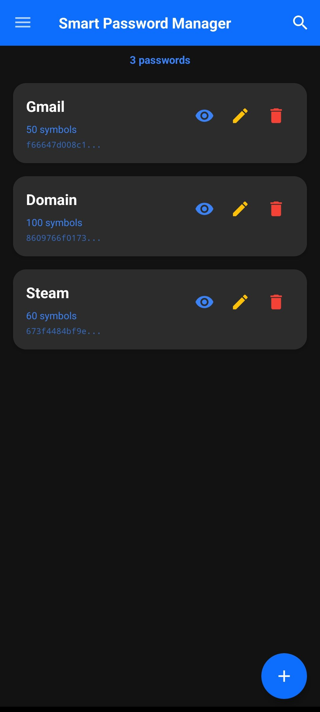
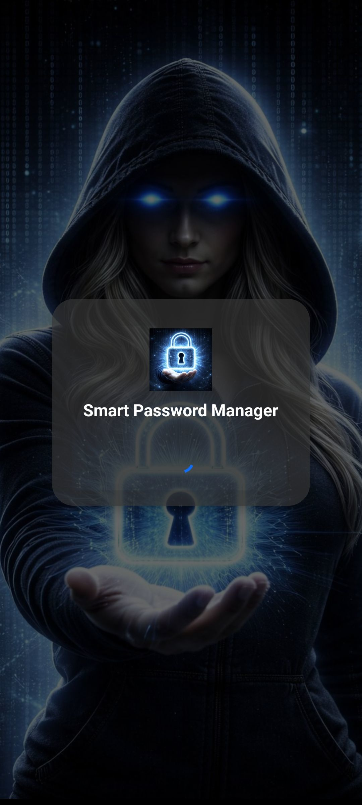
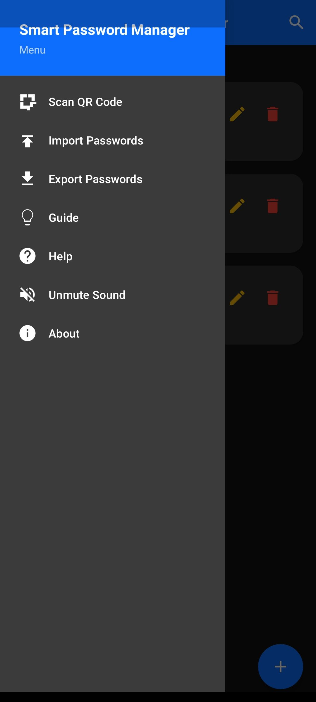

# Smart Password Manager Android v4.1.0

---

**A secure, offline smart password manager for Android with deterministic password generation. Store only metadata - passwords never exist until you generate them.**

**Decentralized by Design**: Unlike traditional password managers that store encrypted vaults on central servers,
Smart Password Manager stores nothing. Your secrets never leave your device. Passwords are regenerated on-demand -
**no cloud, no database, no trust required**.

---

[](https://github.com/smartlegionlab/smart-password-manager-android)
[](https://github.com/smartlegionlab/smart-password-manager-android/blob/master/LICENSE)
[](https://github.com/smartlegionlab/smart-password-manager-android/)
[](https://github.com/smartlegionlab/smart-password-manager-android/stargazers)
[](https://github.com/smartlegionlab/smart-password-manager-android/network/members)
[](https://www.android.com/)

---

## Disclaimer

**By using this software, you agree to the full disclaimer terms.**

**Summary:** Software provided "AS IS" without warranty. You assume all risks.

**Full legal disclaimer:** See [DISCLAIMER.md](https://github.com/smartlegionlab/smart-password-manager-android/blob/master/DISCLAIMER.md)

---

## Core Principles

- **Zero-Storage Security**: No passwords or secret phrases are ever stored or transmitted
- **Decentralized Architecture**: No central servers, no cloud dependency, no third-party trust required
- **Deterministic Regeneration**: Passwords are recreated identically from your secret phrase
- **Metadata Only**: Store only descriptions and verification keys
- **On-Device Generation**: All cryptographic operations happen locally on your Android device
- **On-Demand Discovery**: Passwords exist only when you generate them

## Key Features

- **Decentralized & Serverless**: No central database, no cloud lock-in, complete user sovereignty
- **Smart Password Generation**: Deterministic from secret phrase + length
- **Offline-First**: Works completely without internet connection
- **Cross-Platform Compatible**: Same passwords as all other SmartPassLib implementations
- **Public Key Verification**: Verify secret knowledge without exposing the secret
- **Material Design UI**: Clean, intuitive interface with dark theme support
- **Navigation Drawer Menu**: Slide-out menu from the left with all actions
- **Sound Toggle**: Mute or unmute all app sounds from the menu (enabled by default)
- **Instant Search**: Quickly find passwords by description as you type
- **Drag & Drop Reordering**: Customize password order with long press and drag
- **QR Code Import**: Scan QR codes to import passwords from other devices
- **Secure Secret Entry**: Hidden input with show/hide toggle
- **One-Tap Copy**: Copy generated passwords to clipboard instantly
- **Export/Import**: Backup and restore your password metadata
- **Onboarding Guide**: Step-by-step introduction for new users
- **Expandable Project Cards**: Detailed info about ecosystem components

---

## Screenshots

| Main Page                                                                                                                                           | Splash Screen                                                                                                                                       | Drawer Menu                                                                                                                                           |
|--------------------------------------------------------------------------------------------------------------------------------------------------------|-----------------------------------------------------------------------------------------------------------------------------------------------------|-------------------------------------------------------------------------------------------------------------------------------------------------------|
|  |  |  |

---

## Quick Start

### Prerequisites
- Android 8.0 (API level 26) or higher
- Storage permission (for backup/export functionality)
- Camera permission (for QR code scanning)

### Installation

1. **Download the APK** from the [Releases](https://github.com/smartlegionlab/smart-password-manager-android/releases) page
2. **Enable "Unknown Sources"** in your Android settings (if needed)
3. **Install the APK** and open the app

### First Launch

1. **Read the Legal Disclaimer** - you must accept to continue
2. **Grant Storage Permission** - required for saving backups in Documents folder
3. **Complete the Onboarding Guide** - 9 steps explaining everything you need to know
4. **Start adding your smart passwords!** (use the green + button in the bottom-right corner)

### Adding a Smart Password

1. Tap the **green (+) button** in the bottom-right corner
2. Enter a **description** (e.g., "Gmail Account")
3. Set **password length** (12-100 characters, default 16)
4. Enter your **secret phrase** (minimum 12 characters)
5. Tap **Save** - only the public key is stored!

### Getting Your Smart Password

1. Tap the **eye icon** on any entry
2. Enter your **secret phrase** (minimum 12 characters)
3. Your smart password is **generated instantly**
4. Tap **Copy** to copy to clipboard

### Search Feature

1. Tap the **search icon** in the toolbar
2. **Start typing** - results appear instantly as you type
3. Search matches are **case-insensitive** and search through descriptions
4. Tap the **close (X) button** to clear search and return to full list
5. Search preserves your custom order - results maintain their relative positions

### Drag & Drop Reordering

1. **Long press** (0.5 seconds) on any password card
2. The card will **highlight with a blue border** + **vibration** feedback
3. **Drag the card up or down** to reorder
4. Other cards will **automatically move out of the way**
5. **Release your finger** - the new order is saved permanently
6. The order persists after app restart and device reboot
7. Works even while searching - reorder your filtered results!

**Order Storage:** Your custom order is saved in a separate `order.json` file, keeping `passwords.json` compatible with other platforms.

### QR Code Import

**Import passwords securely via QR codes** - perfect for transferring entries between devices.

1. Open the **navigation menu (☰)** in the top-left corner
2. Tap **Scan QR Code**
3. Grant **camera permission** when prompted
4. **Scan QR code** containing password length and public key
5. **Enter your secret phrase** to verify ownership
6. **Add description** for the imported entry
7. **Save** - password is ready to use!

**QR Code Format:**
```json
{
  "l": 16,
  "k": "a3f5c8e2d1b4a7c9e6f3b8d2a5c7e9f1b4d6a8c2e5f7b9d3a6c8e1f4b7d9a2c5e8f1"
}
```

- `l` = Password length (12-100 characters)
- `k` = Public key (64-character hex string)

**Features:**
- Continuous autofocus for best scanning results
- Audio feedback (success/error sounds)
- Duplicate detection prevents adding the same secret phrase twice
- Character counter with color-coded indicator for description input

**Generate QR codes** using any SmartPassLib implementation

### Editing & Deleting

- **Edit** - Tap the pencil icon to change description or length only
- **Delete** - Tap the trash icon to remove an entry
- **Note**: Secret phrase cannot be changed - you must delete and recreate

### Export/Import

- **Export** - Open the navigation menu (☰) and tap **Export Passwords**
- **Import** - Open the navigation menu (☰) and tap **Import Passwords**
- **Format**: JSON file containing descriptions, public keys, and lengths

---

## Security Model

### How It Works

| Step | Operation                          | Location     | Stored?  |
|------|------------------------------------|--------------|----------|
| 1    | Enter secret phrase                | Your mind    | Never    |
| 2    | Generate private key (15-30 iter)  | RAM only     | Never    |
| 3    | Generate public key (45-60 iter)   | Device       | Stored   |
| 4    | Generate password from private key | RAM only     | Never    |

### Key Derivation (Same as all SmartPassLib implementations v4.1.0)

| Key Type    | Iterations              | Purpose                                    | Stored? |
|-------------|-------------------------|--------------------------------------------|---------|
| Private Key | 15-30 (dynamic)         | Password generation                        | Never   |
| Public Key  | 45-60 (dynamic)         | Secret verification (proof of knowledge)   | Yes     |

### Character Set (Google-compatible)
```
!@#$%^&*()_+-=[]{};:,.<>?/ABCDEFGHIJKLMNOPQRSTUVWXYZ0123456789abcdefghijklmnopqrstuvwxyz
```

### Security Requirements

| Field           | Minimum  | Default   | Maximum   |
|-----------------|----------|-----------|-----------|
| Secret phrase   | 12 chars | -         | unlimited |
| Password length | 12 chars | 16 chars  | 100 chars |
| Description     | 1 char   | -         | 255 chars |

---

## Important Security Notes

### Secret Phrase Rules
- **Minimum 12 characters** (strictly enforced)
- Case-sensitive
- Use a mix of: uppercase, lowercase, numbers, symbols, emoji, or Cyrillic
- **Never store digitally**
- **NEVER use your password description as your secret phrase**

### Strong Secret Examples
```
"MyStrongSecretPhrase2026!" - mixed case + numbers + symbols
"P@ssw0rd!LongSecret" - special chars + numbers + length
"КотБегемот2026НаДиете" - Cyrillic + numbers
```

### Weak Secret Examples (AVOID)
```
"Gmail Account" - using description as secret
"password" - dictionary word, too short
"1234567890" - only digits, too short
"qwerty123" - keyboard pattern
Same as description - never use the same as description
```

### Decentralized Nature

**There is no "forgot password" button.** This is by design:

- No central server can reset your passwords
- No support team can recover your access
- Your secret phrase is the ONLY key

**This is the price of true decentralization** - you are completely in control.

### Critical Warnings
- **Secret phrases are NEVER stored** - if forgotten, passwords cannot be recovered
- **Smart passwords are NEVER stored** - they only exist when generated
- **Same secret + same length = same password everywhere** (cross-platform!)
- **Export your metadata regularly** as backup

---

## Research Paradigms & Publications

- **[Pointer-Based Security Paradigm](https://github.com/smartlegionlab/pointer-based-security-paradigm)** - Architectural Shift from Data Protection to Data Non-Existence
- **[Local Data Regeneration Paradigm](https://github.com/smartlegionlab/local-data-regeneration-paradigm)** - Ontological Shift from Data Transmission to Synchronous State Discovery

---

## Technical Foundation

Powered by **[smartpasslib-kotlin](https://github.com/smartlegionlab/smartpasslib-kotlin) v4.1.0+** - Native Kotlin implementation of deterministic password generation.

**Cryptographic Specifications (v4.1.0):**

| Component              | Specification                      |
|------------------------|------------------------------------|
| Hash Algorithm         | SHA-256                            |
| Private Key Iterations | 15-30 (dynamic, per secret)        |
| Public Key Iterations  | 45-60 (dynamic, per secret)        |
| Key Derivation Salt    | "private"/"public"                 |
| Password Generation    | Deterministic from private key     |
| Min Secret Length      | 12 characters                      |
| Password Length Range  | 12-100 characters                  |

**Decentralized Architecture**:
- No central authority required
- Metadata can be synced via any channel
- Your security depends only on your secret phrase
- Works offline - no internet connection required

---

## Permissions

| Permission                            | Required For                       |
|---------------------------------------|------------------------------------|
| CAMERA                                | QR code scanning                   |
| MANAGE_EXTERNAL_STORAGE (Android 11+) | Saving backups to Documents folder |
| WRITE_EXTERNAL_STORAGE (Android 10-)  | Export/Import functionality        |

**Note:** Storage permission is required for backup/export only. Camera permission is required only for QR scanning. The app works completely offline and never transmits data.

---

## Storage Locations

| Type          | Path                                                          |
|---------------|---------------------------------------------------------------|
| Metadata file | `Documents/smart_password_manager_android/passwords.json`     |
| Order file    | `Documents/smart_password_manager_android/order.json`         |
| Sound setting | `SharedPreferences` (`app_prefs` → `sound_enabled`)           |

**Export files** are saved to the same directory with timestamp: `passwords_export_YYYYMMDD_HHMMSS.json`

---

## Cross-Platform Compatibility

Smart Password Manager Android produces **identical passwords** to:

| Platform   | Application                                                                                                               |
|------------|---------------------------------------------------------------------------------------------------------------------------|
| Web        | [Web Manager](https://github.com/smartlegionlab/smart-password-manager-web)                                               |
| Desktop    | [Desktop Manager](https://github.com/smartlegionlab/smart-password-manager-desktop)                                       |
| CLI        | [CLI PassMan](https://github.com/smartlegionlab/clipassman) / [CLI PassGen](https://github.com/smartlegionlab/clipassgen) |
| Python     | [smartpasslib](https://github.com/smartlegionlab/smartpasslib)                                                            |
| Go         | [smartpasslib-go](https://github.com/smartlegionlab/smartpasslib-go)                                                      |
| Kotlin     | [smartpasslib-kotlin](https://github.com/smartlegionlab/smartpasslib-kotlin)                                              |
| JavaScript | [smartpasslib-js](https://github.com/smartlegionlab/smartpasslib-js)                                                      |
| C#         | [smartpasslib-csharp](https://github.com/smartlegionlab/smartpasslib-csharp)                                              |
| Rust       | [smartpasslib-rs](https://github.com/smartlegionlab/smartpasslib-rs)                                                      |

**Data transfer:** Use QR codes or Export/Import to sync metadata across all platforms.

---

## Ecosystem

This Android application is part of a comprehensive suite:

### Core Libraries
- **[smartpasslib](https://github.com/smartlegionlab/smartpasslib)** - Python
- **[smartpasslib-js](https://github.com/smartlegionlab/smartpasslib-js)** - JavaScript
- **[smartpasslib-kotlin](https://github.com/smartlegionlab/smartpasslib-kotlin)** - Kotlin (used in this app)
- **[smartpasslib-go](https://github.com/smartlegionlab/smartpasslib-go)** - Go
- **[smartpasslib-csharp](https://github.com/smartlegionlab/smartpasslib-csharp)** - C#
- **[smartpasslib-rs](https://github.com/smartlegionlab/smartpasslib-rs)** - Rust

**CLI Applications:**
- **[CLI Smart Password Manager (Python)](https://github.com/smartlegionlab/clipassman)**
- **[CLI Smart Password Generator (Python)](https://github.com/smartlegionlab/clipassgen)**
- **[CLI Smart Password Manager (C#)](https://github.com/smartlegionlab/SmartPasswordManagerCsharpCli)**
- **[CLI Smart Password Generator (C#)](https://github.com/smartlegionlab/SmartPasswordGeneratorCsharpCli)**
- **[CLI Smart Password Manager (Rust)](https://github.com/smartlegionlab/smart-password-manager-cli-rs)**

**Desktop Applications:**
- **[Desktop Smart Password Manager (Python)](https://github.com/smartlegionlab/smart-password-manager-desktop)**
- **[Desktop Smart Password Manager (C#)](https://github.com/smartlegionlab/SmartPasswordManagerCsharpDesktop)**
- **[Desktop Smart Password Manager (Rust, GUI)](https://github.com/smartlegionlab/smart-password-manager-gui-rs)**
- **[Desktop Smart Password Manager (Rust, TUI)](https://github.com/smartlegionlab/smart-password-manager-tui-rs)**

**Other:**
- **[Web Smart Password Manager](https://github.com/smartlegionlab/smart-password-manager-web)**
- **[Android Smart Password Manager](https://github.com/smartlegionlab/smart-password-manager-android)** (this)

---

## User Interface Guide

### Main Screen
- **Password Cards** - List of all your smart password entries
- **Description** - Your custom label for each entry (expandable if >20 chars)
- **Length** - Shows password length in symbols
- **Public Key Preview** - First 12 chars of verification key

### Toolbar Buttons
| Button      | Action                                                   |
|-------------|----------------------------------------------------------|
| Menu (☰)    | Open navigation drawer from the left                     |
| Search (🔍) | Open search bar to filter passwords                      |

### Navigation Drawer Menu
| Option         | Action                                       |
|----------------|----------------------------------------------|
| Scan QR Code   | Import password via QR code                  |
| Import Passwords | Restore metadata from backup               |
| Export Passwords | Backup all metadata to JSON file           |
| Help           | Open help documentation                      |
| Guide          | Open onboarding guide                        |
| Sound Toggle   | Mute / Unmute all app sounds                 |
| About          | Show app info and ecosystem links            |

### Floating Action Button
| Button   | Action                          |
|----------|---------------------------------|
| + (green) | Create new smart password entry |

### Search Bar
| Button        | Action                                      |
|---------------|---------------------------------------------|
| Close (✕)     | Clear search and return to full list        |
| Typing        | Instant filtering by description            |

### Entry Card Buttons
| Button     | Action                                                |
|------------|-------------------------------------------------------|
| Eye        | Generate and display smart password (requires secret) |
| Edit       | Change description or length (secret cannot change)   |
| Delete     | Remove entry permanently                              |
| Arrow      | Expand/collapse long description (>20 chars)          |

### Drag & Drop
| Action                                | Result                                    |
|---------------------------------------|-------------------------------------------|
| Long press (0.5 sec) on any card      | Card highlights blue + vibration          |
| Drag up/down                          | Cards reorder automatically               |
| Release finger                        | New order saved permanently               |

### Sound Settings
| Action                                | Result                                    |
|---------------------------------------|-------------------------------------------|
| Menu → "Mute Sound"                   | Disables all app sounds                   |
| Menu → "Unmute Sound"                 | Re-enables all app sounds                 |
| Default state                         | Sound is enabled                          |
| Persistence                           | Saved in SharedPreferences                |

---

## Development

### Build Requirements
- Android Studio Hedgehog | 2023.1.1 or higher
- JDK 11 or higher
- Android SDK with API 34

### Build from Source

```bash
# Clone the repository
git clone https://github.com/smartlegionlab/smart-password-manager-android.git

# Open in Android Studio
# Wait for Gradle sync to complete

# Build the APK
./gradlew assembleDebug
```

---

## License

BSD 3-Clause [License](LICENSE)

```
Copyright (©) 2026, Alexander Suvorov. All rights reserved.
```

## Author

Alexander Suvorov - [GitHub](https://github.com/smartlegionlab)

## Support

- **Issues**: [GitHub Issues](https://github.com/smartlegionlab/smart-password-manager-android/issues/)
- **Core Library Issues**: [smartpasslib Issues](https://github.com/smartlegionlab/smartpasslib/issues)
- **Ecosystem**: [Smart Passwords Ecosystem](https://smartlegionlab.github.io/ecosystems/smart-passwords-ecosystem.html)

---

Made with care for privacy and security
